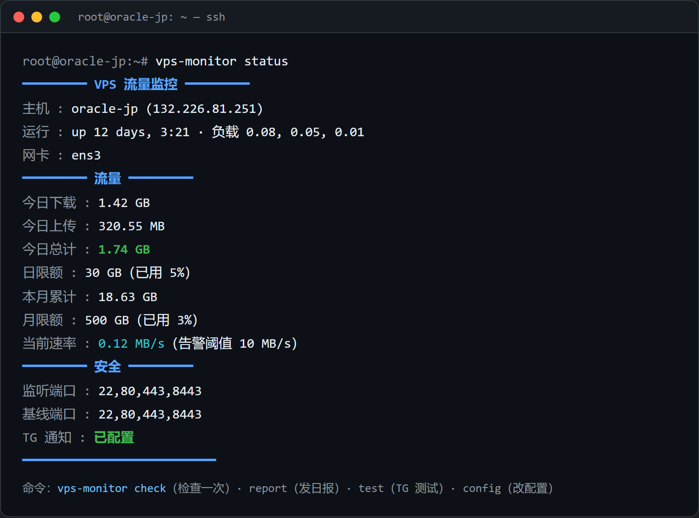
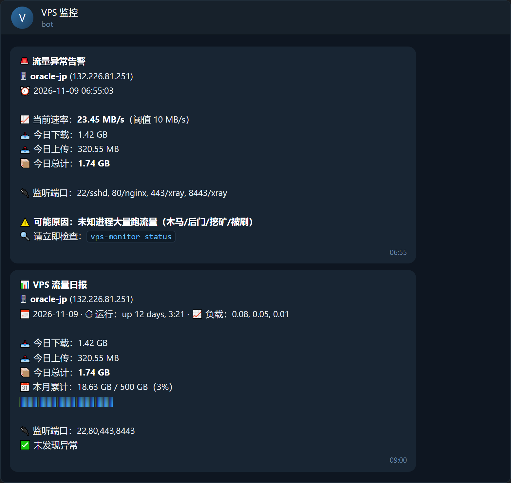

# vps-traffic-monitor

免费 VPS 流量监控 + Telegram 告警，**一个 bash 脚本搞定**。无后台、无订阅、无依赖面板。




## 功能

| 功能 | 说明 |
|------|------|
| 📊 流量统计 | 今日 / 本月 上传+下载（读 `/proc/net/dev`，不依赖 vnstat） |
| 📈 速率告警 | 每 5 分钟采样，突发高流量立即 TG 告警（疑似木马/后门/挖矿跑流量） |
| 🔌 端口基线 | 新增监听端口立即告警（疑似后门开端口），告警带进程名 |
| 🔗 可疑出站 | 连接木马/远控/矿池常用端口（4444/5555/6667/1337…）时告警 |
| ⚠️ 额度告警 | 日 / 月流量达到 80% / 100% 时告警，每周期只提醒一次 |
| 📩 每日日报 | 每天 09:00 TG 流量日报（运行时长、负载、端口、月进度条） |
| 🖥 终端仪表盘 | `vps-monitor status` 随时看实时速率与安全状态 |

## 安装

```bash
curl -Ls https://raw.githubusercontent.com/hahafeng9/vps-traffic-monitor/main/vps-monitor.sh -o /tmp/vps-monitor.sh
bash /tmp/vps-monitor.sh install
```

`install` 会自动完成：复制到 `/usr/local/bin/vps-monitor`、注册 systemd 定时任务（check 每 5 分钟 + report 每天 9 点）；无 systemd 的系统自动改用 cron。

```bash
vps-monitor config   # 配置 TG bot token / chat id / 阈值
vps-monitor test     # 发一条测试消息确认 TG 通了
```

> **TG 配置方法**：@BotFather 新建 bot 拿 token → 给 bot 发一条 `/start` → @userinfobot 查你的 chat id。

## 命令

| 命令 | 说明 |
|------|------|
| `vps-monitor status` | 终端仪表盘（流量、速率、端口、配置状态） |
| `vps-monitor check` | 立即检查一次，异常发 TG |
| `vps-monitor report` | 立即发一次 TG 日报 |
| `vps-monitor test` | 发一条 TG 测试消息 |
| `vps-monitor config` | 交互式配置 |
| `vps-monitor baseline` | 重新采集监听端口基线（装了新服务后跑一次） |
| `vps-monitor uninstall` | 卸载（服务/定时任务/配置/状态全清） |

## 配置（/etc/vps-monitor.conf，600 权限）

```bash
BOT_TOKEN="123456:ABC-xxx"       # TG bot token
CHAT_ID="6408048903"             # TG chat id
TG_API="https://api.telegram.org" # TG API 地址（见 FAQ）
SPIKE_MBPS=10                    # 速率告警阈值（MB/s）
DAILY_LIMIT_GB=0                 # 日流量上限 GB，0=不限
MONTHLY_LIMIT_GB=500             # 月流量上限 GB，0=不限
REPORT_HOUR=9                    # 每日日报时间（0-23 点）
ALERT_COOLDOWN=3600              # 同类告警冷却（秒）
```

改 `REPORT_HOUR` / 阈值后跑一次 `vps-monitor install` 会同步更新定时任务。

## 告警类型

| 告警 | 触发条件 |
|------|----------|
| 🚨 流量异常 | 5 分钟平均速率超过 `SPIKE_MBPS` |
| 🚨 新增监听端口 | 出现基线之外的监听端口（含进程名） |
| 🚨 可疑出站 | 连接到 4444/5555/6667/1337/31337 等端口 |
| ⚠️ 日/月流量 | 达到限额 80%（提醒）/ 100%（超限） |

同类告警有冷却时间（默认 1 小时），不会刷屏。

## FAQ

**TG 发不出去 / VPS 在受限网络？**
在 `/etc/vps-monitor.conf` 里把 `TG_API` 改成任意 TG Bot API 反代地址即可，例如 Cloudflare Workers 自建的反代。

**状态文件在哪？会不会很大？**
`/var/lib/vps-monitor/`，一个几百字节的状态文件 + 日志，没有数据库。

**换了新服务/新端口总是告警？**
跑 `vps-monitor baseline` 重新采集基线。

**支持什么系统？**
任何 Linux：Debian / Ubuntu / CentOS / Alpine（需 `curl`、`awk`，`ss` 或 `netstat` 任一）。systemd 或 cron 任一存在即可自动定时。

## 卸载

```bash
vps-monitor uninstall
```
